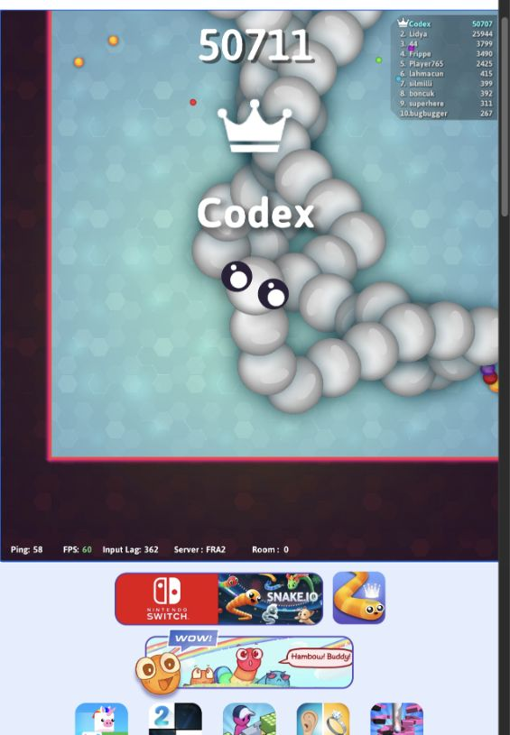
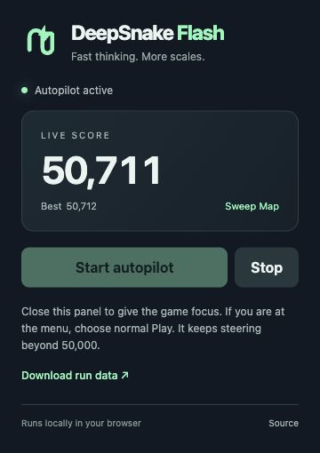

# DeepSnake Flash ⚡🐍

**Fast thinking. More scales.** A DeepSeek pun with a Snake.io habit.

A browser-local autopilot that reads the Unity client's predicted world, plans around moving snakes, and sends ordinary mouse movement and boost inputs. It reached **50,711 and first place from normal Play**, then kept going. The native scoreboard screenshot and exact 50,000 milestone receipt are included.



## Play with it

1. **[Download the extension ZIP](https://github.com/stevenkippax/DeepSnake-Flash/releases/latest/download/deepsnake-flash-extension.zip)** and extract it into a folder.
2. Open `chrome://extensions` (or `edge://extensions`), enable **Developer mode**, and choose **Load unpacked**. Select the extracted folder containing `manifest.json`.
3. Open **[snake.io](https://snake.io)** and let the game load.
4. Open **DeepSnake Flash** from your extensions and press **Start autopilot**. Close the panel to give the game focus, then choose the game's normal **Play** button.
5. Let it steer. Reopen the panel to see the score, **Stop**, or **Download run data**.

Start also works during an existing game. Repeated Start clicks preserve an already-running controller. Reaching 50,000 keeps steering and milestone recording active. Menus, ads, retries, and revive choices remain under your control.

Keep the game visible and focused. A page reload clears the controller; start it again afterward. Use a mouse or keyboard to take over after Stop. The extension requires Chromium 95+ and uses temporary access to the active tab when you click it.

<details><summary>Standalone script for the browser console</summary>

Download [deepsnake-flash.js](https://github.com/stevenkippax/DeepSnake-Flash/releases/latest/download/deepsnake-flash.js). After Snake.io loads, open your browser's developer console and run the file contents. It arms the same controller. To stop:

```js
window.__snakeWorldController?.stop();
window.__snakeGoalMonitor?.stop();
window.__snakeSessionRecovery?.stop();
```

The extension is the easier route for routine play.
</details>



*Extension panel preview; the native game screenshot above is the score evidence.*

## What it does

- Reads predicted head positions, turning limits, input delay, body geometry, food renderers, and arena bounds from the local Unity client.
- Models queued input before choosing a turn, then checks a six-second continuation.
- Detects developing wraps and narrow exits, retains escape intent, and looks for timed openings behind departing tails.
- Seeks rich food across the reachable map and investigates large-rival disappearances.
- Uses committed map sweeps to break tight loops and guarded flanks to pressure rivals.
- Evaluates buffered head interceptions with a shared alignment/boost speed schedule.
- Records score milestones beyond 50,000 and exports compact run receipts.

Decisions run inside the browser with `requestAnimationFrame`; there is no model or network round trip in the steering loop. The extension contains all its code and makes no analytics or API requests. Its page inputs are mouse movement, mouse down, and mouse up. Native score, physics, rewards, and packets are read-only.

## Evidence and limits

[Native screenshots](docs/screenshots) show score milestones from the demonstrated run. [The 50,000 receipt](docs/50000-receipt.json) records an active game and input sender at the crossing. That run used normal Play and no revive or Start Big bonus. The crossing occurred after about 128 minutes of the recorded run.

This is an experimental autopilot, not an unbeatable strategy. Enclosures still occurred, opponents can change direction, and server or focus interruptions can change what the client observes. The safety check certifies a continuation under its observed model; it does not prove immunity to every future rival input. A disappeared rival is a search hint until food confirms an opportunity.

Runtime discovery targets the Unity 2021.3 / IL2CPP v29 Snake.io client used for this demonstration. Client updates can change metadata or field layouts. Submit an issue with the browser version and error if a new build breaks it.

## Build and test

Node.js 20+ is sufficient. There are no package dependencies.

```sh
npm test
npm run build
```

Build outputs: `dist/deepsnake-flash-extension.zip`, `dist/deepsnake-flash.js`, and `dist/SHA256SUMS.txt`. You can load the local `extension/` folder after building.

The suite checks queued movement, arena recovery, moving heads, narrow pockets, nested enclosures, departure timing, food routes, committed movement, and interceptions. Synthetic tests and captured geometry check the planner; the native scoreboard proves the score. [Architecture and validation](docs/ARCHITECTURE.md) explains the layers.

| Path | Contents |
| --- | --- |
| `src/` | Runtime reader, topology planner, controller, observers |
| `extension/` | Start/Stop popup and MAIN-world injection bridge |
| `tests/` | Regression checks and reduced geometry fixtures |
| `docs/` | Native screenshots, receipt, and design notes |
| `research/experiments/` | Authored historical snapshots and development scripts |
| `scripts/` | Dependency-free test runner and reproducible ZIP builder |

The research folder is an archive; `src/` is the release implementation. Snake.io loads its own game assets from its site.

## Credits

Created by **Steven Kippax** with Codex. [slimy-snake](https://github.com/jfbarras/slimy-snake) inspired the pursuit of a fast local controller. This implementation follows Snake.io's observed Unity client and its own regression fixtures.

Unofficial project, independent of Snake.io and DeepSeek. MIT-licensed controller code; game branding and screenshot content belong to their respective owners.
